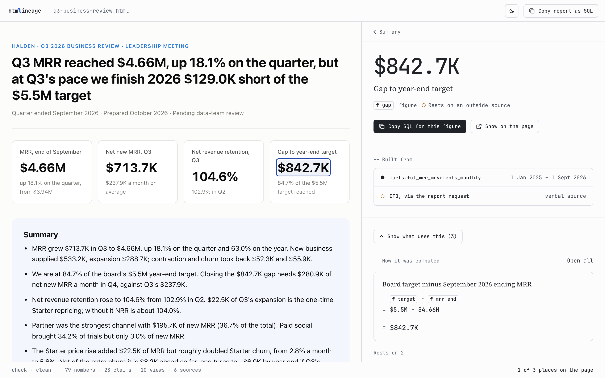

<picture>
  <source media="(prefers-color-scheme: dark)" srcset=".github/assets/logo-dark.svg">
  
</picture>

**A provenance layer for AI-generated reports.** Every number, chart, and claim traces back to the query that produced it.

<picture>
  <source media="(prefers-color-scheme: dark)" srcset=".github/assets/viewer-dark.png">
  
</picture>

<sub>The viewer on a sample report. Halden is a fictional company and its data is made up.</sub>

AI writes analytics reports faster than data teams can vet them. htmlineage records where each figure came from — `source → view → figure → insight` — so a reviewer can see the lineage behind any claim before it reaches a CXO deck. A skill teaches your AI assistant to record that lineage while it builds a report, and a small CLI checks it, composes it into one SQL script, and shows it beside the report.

- **Visibility, not verification.** htmlineage shows the lineage; it doesn't assert the numbers are right.
- **Zero builder friction.** Reports stay plain `.html`. Lineage rides along in an inert `<script type="application/lineage+json">` block and `data-lineage` attributes — invisible to the reader.
- **SQL-first evidence.** Compose an entire report back into one runnable SQL script for review.
- **Pinned time.** Queries use absolute date ranges, never `now()`, so a report reproduces exactly.

## Status

**Beta.** The lineage format may still change before `0.1.0`.

## Install

**The skill** follows the open [Agent Skills](https://agentskills.io) standard, so it works with Claude Code, Codex, Cursor, Gemini CLI, GitHub Copilot and other tools that read skills. Install it with [skills.sh](https://skills.sh):

```bash
npx skills add htmlineage/htmlineage -s htmlineage
```

Or copy [`skills/htmlineage/`](skills/htmlineage/) into your tool's skills folder (for example `.claude/skills/` for Claude Code, `.agents/skills/` for most others).

The skill is opt-in: your assistant uses it when you ask for a report that will be reviewed, traced or shared with leadership, and not for quick questions. To use it for every report in a repository, add a line such as "Every report built here uses htmlineage" to the instructions file your tool reads (`AGENTS.md`, `CLAUDE.md` or similar).

**The CLI** needs Node 18 or later and nothing else. There is nothing to install: run it with `npx`.

```bash
npx htmlineage --help
```

## Build and check a report

### 1. Ask for a report

Tell your assistant you want a report that will be reviewed, traced or shared with leadership. The assistant writes the report as plain HTML and, beside it, the lineage graph in `.lineage/<report>.json`.

### 2. Check it

This validates the graph against the report, embeds it into the HTML, and prints a summary. It exits `0` when the report passes (warnings still pass) and `1` when it does not.

```bash
npx htmlineage check report.html
```

It reads the graph from `.lineage/<report>.json` beside the report, or else the block already embedded in the report; `--graph <path>` reads that file instead. Use `--no-embed` to leave the file untouched and `--json` for machine-readable output. The rules and what each message means are in [CHECKS.md](https://github.com/htmlineage/htmlineage/blob/main/CHECKS.md).

### 3. Open it

This serves a two-pane page on 127.0.0.1: the report on the left, the lineage of whatever you click on the right.

```bash
npx htmlineage view report.html
```

### 4. Compose the SQL

This joins every source, view, and figure into a single script a reviewer can paste into the warehouse. A report that fails `check` is refused.

```bash
npx htmlineage sql report.html > report.sql
npx htmlineage sql report.html --id f3 > f3.sql
```

`--id <node>` composes only that node and everything it rests on.

Each command has its own options: run `npx htmlineage <command> --help`.

## Review a report

To review a report someone else built, ask your assistant to review it. The skill then follows [the review guide](skills/htmlineage/references/review.md): read the check summary, trace the numbers that carry the report, and say where the evidence is weak.

To do it yourself, run `check`, click through the report in `view`, and run `sql --id` on the numbers that matter.

`view` serves the report, its graph and files beside the report such as images, only on 127.0.0.1. It never serves any other file whose name starts with a dot or that lies outside the report's folder, and it needs no database or credentials. More in [SECURITY.md](SECURITY.md).

## How lineage is recorded

A report's graph is a JSON object with a `nodes` map. Each node is one of four steps:

| Step        | Id  | What it is                                                              |
| ----------- | --- | ----------------------------------------------------------------------- |
| **source**  | `q` | One wide query per dataset, with a pinned date range                    |
|             | `x` | An external source htmlineage cannot see inside (a CSV, a document)     |
| **view**    | `v` | A `select` over sources or views, shown as a table or chart             |
| **figure**  | `f` | A single value picked from a view, or a SQL expression over figures     |
| **insight** | `i` | A claim resting on views, figures or insights, or flagged as ungrounded |

Elements on the page point at nodes:

```html
<div class="kpi-value" data-lineage="f1">46.6%</div>
```

Every field of every step is in the [field reference](skills/htmlineage/references/format.md), and a complete short report with its graph is in the [worked example](skills/htmlineage/references/example/).

## License

Apache-2.0 © Varun Jain
